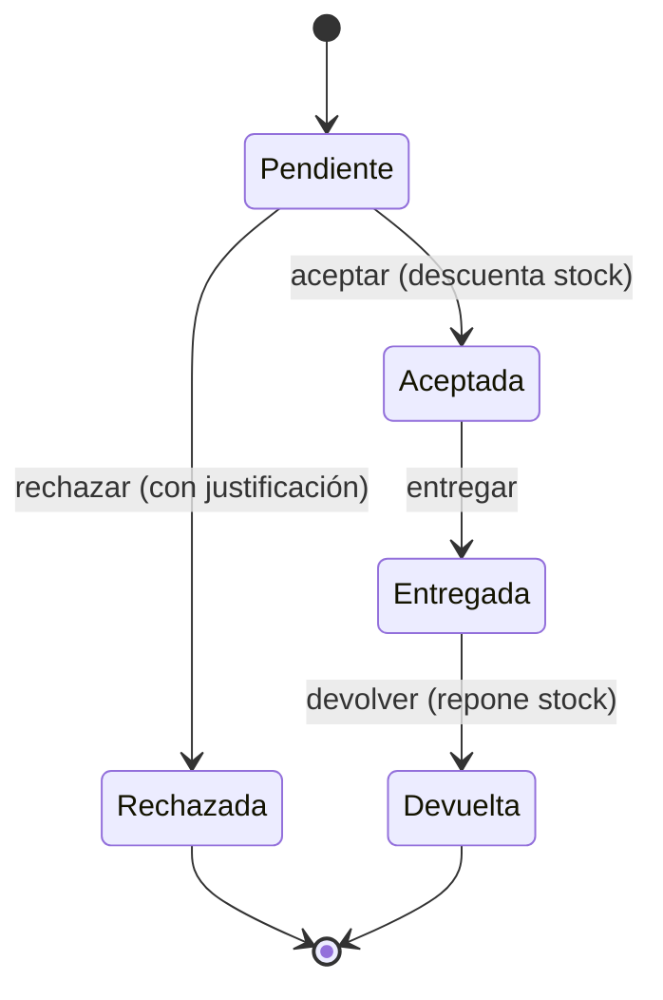
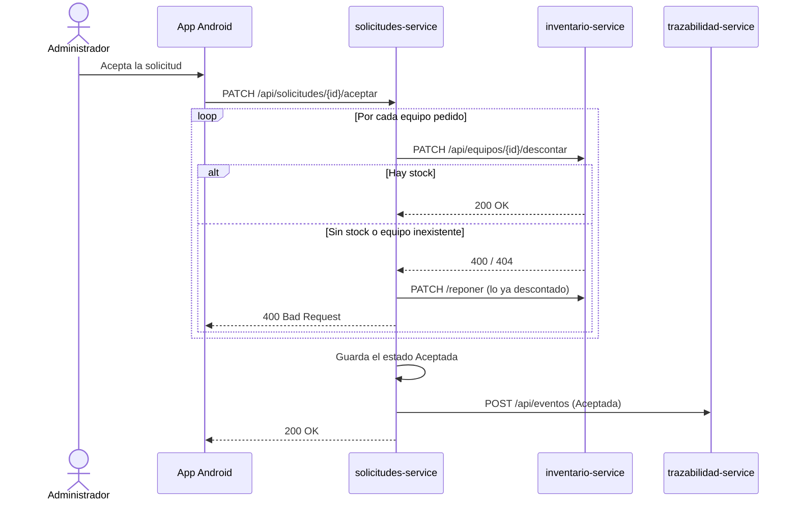

# MPAZ Pañol · Microservicios


Backend de **MPAZ Pañol**, la app móvil para gestionar el inventario, la reserva y el préstamo de equipos tecnológicos de la Escuela Escritora Marcela Paz. Controla el stock, las solicitudes y la bitácora de préstamos.

Proyecto de la asignatura **DSY1105 · Desarrollo de Aplicaciones Móviles**.
La app Android está en otro repositorio: [MPAZ-EP2-Moviles](https://github.com/beaedov/MPAZ-EP2-Moviles).


## Integrantes

| Nombre | GitHub |
|---|---|
| Benjamin Aedo | [@beaedov](https://github.com/beaedov) |
| Thomas Huenchulao | [@thuenchulao](https://github.com/thuenchulao) |

## Problema que resuelve

Hoy los docentes piden equipos (proyectores, notebooks, kits de robótica) por correo al encargado de TI. Esto provoca reservas duplicadas, solicitudes perdidas y falta de control sobre quién tiene cada equipo.

El backend resuelve tres cosas:

- Lleva el **stock** real de cada equipo.
- Gestiona el **ciclo de vida de cada solicitud**, desde que se pide hasta que se devuelve.
- Deja una **bitácora** con cada cambio de estado, quién lo hizo y cuándo.

## Arquitectura

Tres microservicios en Spring Boot con una única base de datos PostgreSQL, donde cada servicio administra sus propias tablas.

```
                  ┌──────────────────────┐
                  │   App Android        │
                  │ (Retrofit, Kotlin)   │
                  └───┬──────┬──────┬────┘
                      │      │      │
            ┌─────────▼┐ ┌───▼──────┴───┐ ┌▼───────────────┐
            │inventario│ │ solicitudes  │ │ trazabilidad   │
            │  :8081   │◄┤    :8082     ├►│     :8083      │
            └────┬─────┘ └──────┬───────┘ └───────┬────────┘
                 └──────────────┼─────────────────┘
                                ▼
                     ┌─────────────────────┐
                     │ PostgreSQL (mpazdb) │
                     │ Docker · puerto 5434│
                     └─────────────────────┘
```

| Microservicio | Puerto | Responsabilidad | Tablas |
|---|:---:|---|---|
| `inventario-service` | 8081 | Catálogo de equipos y control de stock | `equipos` |
| `solicitudes-service` | 8082 | Solicitudes de préstamo y sus estados | `solicitudes`, `solicitud_items` |
| `trazabilidad-service` | 8083 | Bitácora de cambios de estado | `eventos_solicitud` |

> [!NOTE]
> El login y el registro de usuarios no pasan por el backend: se mantienen en SQLite (Room) dentro de la app.

## Flujo de una solicitud

### Estados



### Qué ocurre al aceptar una solicitud



## Comunicación entre servicios

`solicitudes-service` consume por HTTP (con `WebClient`) a los otros dos:

| Acción en solicitudes | Llamada que realiza |
|---|---|
| Crear | Evento **Pendiente** en trazabilidad |
| Aceptar | `PATCH /descontar` en inventario por cada equipo, y evento **Aceptada** |
| Rechazar | Evento **Rechazada** con la justificación |
| Entregar | Evento **Entregada** |
| Devolver | `PATCH /reponer` en inventario por cada equipo, y evento **Devuelta** |

Reglas de la comunicación:

- **Inventario es obligatorio**: si no hay stock o el equipo no existe, la solicitud no se acepta (`400`).
- **Compensación**: si falla el descuento de un equipo, se reponen los ya descontados para no dejar el stock a medias.
- **Trazabilidad es opcional**: si está caída, solo se deja un aviso en el log y la solicitud igual se guarda.

## Endpoints

La columna **Lo consume** indica quién usa cada endpoint.

### inventario-service · `http://localhost:8081`

| Método | Ruta | Descripción | Respuestas | Lo consume |
|---|---|---|---|---|
| `GET` | `/api/equipos` | Lista equipos (filtros opcionales `?categoria=` y `?estado=`) | 200 | App |
| `GET` | `/api/equipos/{id}` | Obtiene un equipo | 200, 404 | App |
| `POST` | `/api/equipos` | Crea un equipo | 201 | App |
| `PUT` | `/api/equipos/{id}` | Reemplaza los datos de un equipo | 200, 404 | App |
| `PATCH` | `/api/equipos/{id}/descontar?cantidad=` | Descuenta stock disponible | 200, 400, 404 | solicitudes-service |
| `PATCH` | `/api/equipos/{id}/reponer?cantidad=` | Repone stock (sin superar el total) | 200, 404 | solicitudes-service |

Al iniciar por primera vez carga **10 equipos de ejemplo** si la tabla está vacía.

### solicitudes-service · `http://localhost:8082`

| Método | Ruta | Descripción | Respuestas | Lo consume |
|---|---|---|---|---|
| `GET` | `/api/solicitudes` | Lista solicitudes (filtros opcionales `?email=` y `?estado=`) | 200 | App |
| `GET` | `/api/solicitudes/{id}` | Obtiene una solicitud | 200, 404 | App |
| `POST` | `/api/solicitudes` | Crea una solicitud (queda **Pendiente**) | 201 | App |
| `PATCH` | `/api/solicitudes/{id}/aceptar` | Pendiente → Aceptada (descuenta stock) | 200, 400, 404 | App |
| `PATCH` | `/api/solicitudes/{id}/rechazar?comentario=` | Pendiente → Rechazada (justificación obligatoria) | 200, 400, 404 | App |
| `PATCH` | `/api/solicitudes/{id}/entregar` | Aceptada → Entregada | 200, 400, 404 | — |
| `PATCH` | `/api/solicitudes/{id}/devolver` | Entregada → Devuelta (repone stock) | 200, 400, 404 | — |

<details>
<summary>Ejemplo de body para <code>POST /api/solicitudes</code></summary>

```json
{
  "solicitanteNombre": "Docente Prueba",
  "solicitanteEmail": "docente@mpaz.cl",
  "equipos": "Proyector Epson x2",
  "sala": "Sala 5",
  "fecha": "20/11/2026",
  "horaInicio": "10:00",
  "horaDevolucion": "11:00",
  "items": [ { "equipoId": 1, "cantidad": 2 } ]
}
```

`equipos` es el resumen que se muestra al usuario; `items` indica qué equipo y cuántas unidades se descuentan del inventario.

</details>

### trazabilidad-service · `http://localhost:8083`

| Método | Ruta | Descripción | Respuestas | Lo consume |
|---|---|---|---|---|
| `POST` | `/api/eventos` | Registra un evento de una solicitud | 201, 400 | solicitudes-service |
| `GET` | `/api/eventos` | Lista eventos (filtro opcional `?estado=`) | 200 | App |
| `GET` | `/api/eventos/solicitud/{solicitudId}` | Historial de una solicitud | 200 | App |

Estados válidos: `Pendiente`, `Aceptada`, `Rechazada`, `Entregada`, `Devuelta`. `Rechazada` exige un comentario.

## Modelo de datos

| Tabla | Campos principales |
|---|---|
| `equipos` | id, nombre, marca, modelo, categoria, stockTotal, stockDisponible, estado, ubicacion |
| `solicitudes` | id, solicitanteNombre, solicitanteEmail, equipos, sala, fecha, horaInicio, horaDevolucion, estado, fechaCreacion, comentario |
| `solicitud_items` | solicitud_id, equipoId, cantidad |
| `eventos_solicitud` | id, solicitudId, estado, fechaHora, actor, comentario |

## Tecnologías y estructura

Java 21, Spring Boot 4.1 (Web, Data JPA, WebFlux para `WebClient`), PostgreSQL 18, Docker Compose, Lombok, JUnit 5, Mockito y Maven.

```
Mpaz-panol_Microservicios_Aedo_Huenchulao
├── docker-compose.yml        → PostgreSQL
├── inventario-service
├── solicitudes-service
└── trazabilidad-service

com.mpaz.<servicio>
├── config        → Configuración (datos iniciales, WebClient)
├── controller    → Endpoints REST
├── service       → Lógica de negocio (interfaz + implementación)
├── repository    → Acceso a la base de datos (Spring Data JPA)
└── entity        → Entidades que se guardan como tablas
```

## Cómo ejecutar

**Requisitos:** JDK 21, Maven (o el `mvnw` incluido) y Docker Desktop.

**1. Clonar el repositorio**
```bash
git clone https://github.com/thuenchulao/Mpaz-panol_Microservicios_Aedo_Huenchulao.git
cd Mpaz-panol_Microservicios_Aedo_Huenchulao
```

**2. Crear el archivo `.env`** en la raíz, junto a `docker-compose.yml`
```
DB_USER=postgres
DB_PASSWORD=postgres
```

> [!WARNING]
> El `.env` no se sube a GitHub. Estas credenciales son solo para desarrollo local.

**3. Levantar la base de datos** (crea `mpazdb` en el puerto 5434)
```bash
docker compose up -d
```

**4. Levantar cada microservicio**, desde IntelliJ (clase `...Application`) o desde la terminal (en Windows usa `mvnw.cmd`):
```bash
cd inventario-service && ./mvnw spring-boot:run
cd solicitudes-service && ./mvnw spring-boot:run
cd trazabilidad-service && ./mvnw spring-boot:run
```

Las tablas se crean solas al iniciar (`ddl-auto: update`).

> [!TIP]
> Si al iniciar aparece `Connection refused` en el puerto 5434, falta abrir Docker Desktop o ejecutar `docker compose up -d`.

<details>
<summary>Variables de configuración</summary>

Todas tienen valor por defecto para desarrollo local: `PORT` (8081 / 8082 / 8083), `DB_HOST` (`localhost`), `DB_PORT` (`5434`), `DB_NAME` (`mpazdb`), `DB_USER` y `DB_PASSWORD` (`postgres`), `DDL_AUTO` (`update`) y `SHOW_SQL` (`true`).

</details>

## Cómo probar (Postman)

Con la base y los tres servicios levantados:

| Paso | Petición | Resultado esperado |
|:---:|---|---|
| 1 | `POST http://localhost:8082/api/solicitudes` con el body de ejemplo | 201, estado `Pendiente` |
| 2 | `GET http://localhost:8081/api/equipos/1` | Anotar el `stockDisponible` |
| 3 | `PATCH http://localhost:8082/api/solicitudes/1/aceptar` | Estado `Aceptada` y el stock baja |
| 4 | `PATCH .../1/entregar` y luego `.../1/devolver` | Estado `Devuelta` y el stock vuelve a subir |
| 5 | `GET http://localhost:8083/api/eventos/solicitud/1` | Aparecen todos los estados registrados |

Casos de error que también se pueden probar:

- Aceptar con más unidades de las disponibles: `400` y el stock no cambia.
- Rechazar sin `?comentario=`: `400`.
- Entregar una solicitud que no está Aceptada: `400`.
- Consultar un id inexistente: `404`.

## Pruebas unitarias

Con **JUnit 5** y **Mockito** (`@Mock`, `@InjectMocks`, patrón Arrange-Act-Assert). Los repositorios y las llamadas a otros servicios se simulan, por lo que no necesitan base de datos ni servicios levantados.

| Servicio | Clase | Pruebas |
|---|---|:---:|
| `inventario-service` | `EquipoServiceImplTest` | 6 |
| `solicitudes-service` | `SolicitudServiceImplTest` | 11 |
| `trazabilidad-service` | `EventoServiceImplTest` | 7 |
| | **Total** | **24** |

Validan el descuento y la reposición de stock, el ciclo de estados, la justificación obligatoria al rechazar, el fallo de inventario sin guardar cambios y las validaciones del registro de eventos.

Se ejecutan con `./mvnw test` dentro de cada servicio, o desde IntelliJ (clic derecho en la clase, Run).

## Flujo de trabajo y planificación

- `main`: versión estable para entregar.
- Ramas `feature/...`: nacen de `main` y vuelven mediante Pull Request.
- Tablero de Trello: https://trello.com/b/0l3Gx364/mpazpanol-ep2

---

Todos los datos del sistema (equipos, solicitantes, correos) son ficticios, según la Ley de protección de datos personales.

Todos los datos del sistema (equipos, solicitantes, correos) son ficticios, según la Ley de protección de datos personales.

<sub>Todos los datos del sistema (equipos, solicitantes, correos) son ficticios, según la Ley de protección de datos personales.</sub>

</div>
